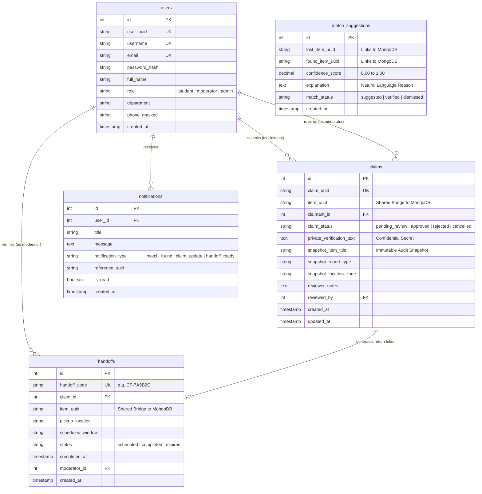
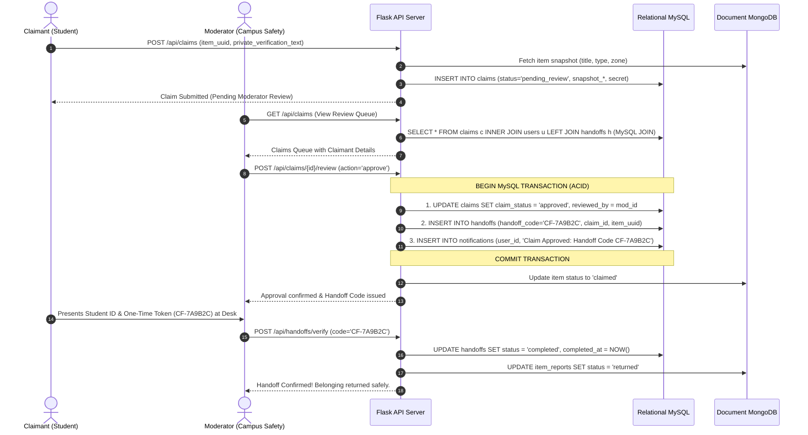

# CAMPUS-FIND: Architecture & Database Schema Documentation

## 1. System Architecture Overview

CAMPUS-FIND uses a **hybrid polyglot persistence architecture**:
- **MongoDB** acts as the flexible document store for varied, semi-structured item reports with nested attributes.
- **MySQL** acts as the transactional relational store for user identities, private claims, match pairs, audit snapshots, notifications, and safe return handoff tokens.
- The two distinct database engines are bridged using a shared, immutable identifier: `item_uuid`.

```
+-----------------------------------------------------------------------------------+
|                           CLIENT LAYER (Single Page App)                          |
|                       index.html (Modern CSS Grid + ES6 JS)                       |
+-----------------------------------------------------------------------------------+
                                          |
                                HTTP / REST JSON
                                          v
+-----------------------------------------------------------------------------------+
|                        BACKEND APPLICATION LAYER (Flask)                         |
|                                                                                   |
|   +-------------------+  +-----------------------+  +-------------------------+   |
|   |  app.py (Routes)  |  |  services.py (Logic)  |  |  Local AI Match Engine  |   |
|   +-------------------+  +-----------------------+  +-------------------------+   |
|            |                                                    |                 |
|            +-------------------------+--------------------------+                 |
|                                      |                                            |
|                  +-------------------+-------------------+                        |
|                  |                                       |                        |
|                  v                                       v                        |
|        +-------------------+                   +-------------------+              |
|        |    db_mongo.py    |                   |    db_mysql.py    |              |
|        +-------------------+                   +-------------------+              |
+------------------|---------------------------------------|------------------------+
                   |                                       |
                   v                                       v
+-------------------------------------+ +-------------------------------------------+
|      DOCUMENT DATA STORE (MongoDB)  | |       RELATIONAL DATA STORE (MySQL)       |
|                                     | |                                           |
| Collection: item_reports            | | Tables:                                   |
| - item_uuid (Shared Bridge Key)     | | - users (Students, Moderators, Admins)    |
| - report_type ("lost" | "found")    | | - claims (Ownership Claims & Snapshots)   |
| - category, title, description      | | - match_suggestions (AI Pair Scores)      |
| - nested_attributes:                | | - notifications (Student Alerts)          |
|     { color, brand, condition... }  | | - handoffs (One-Time Pickup Codes)        |
| - location:                         | |                                           |
|     { campus_zone, building... }    | | ACID Transactions, Strict Foreign Keys,   |
| - urgency_info:                     | | and Relational JOIN Queries               |
|     { is_urgent, reason... }        | |                                           |
+-------------------------------------+ +-------------------------------------------+
                   ^                                       ^
                   +================= item_uuid ============+
                               (Shared Identifier Bridge)
```

---

## 2. Relational MySQL Schema (Entity-Relationship Diagram)



---

## 3. MongoDB Document Structure (`item_reports` Collection)

Each document in MongoDB stores the flexible metadata of an item report, supporting nested structures without rigid SQL schema migrations:

```json
{
  "_id": "ObjectId('673412ab9c7e012345678901')",
  "item_uuid": "cf-item-001",
  "report_type": "found",
  "title": "Space Gray iPad Air 5th Gen",
  "category": "Electronics",
  "status": "claimed",
  "description": "Found on wooden study table near back windows with screen protector.",
  "nested_attributes": {
    "color": "Space Gray",
    "brand": "Apple",
    "model": "iPad Air (5th Generation)",
    "distinguishing_mark": "Scratch shaped like letter V near charging port",
    "condition": "Good"
  },
  "location": {
    "campus_zone": "Central Library",
    "building": "Main Campus Library",
    "floor": "3rd Floor",
    "room_or_area": "North Study Stacks Table #14"
  },
  "urgency_info": {
    "is_urgent": false,
    "urgency_reason": "Secured in Central Library Safe",
    "is_perishable": false
  },
  "dates": {
    "incident_date": "2026-11-10",
    "reported_at": "2026-11-10T14:30:00Z"
  },
  "reporter": {
    "user_uuid": "usr-student-002",
    "display_name": "Alex Chen",
    "role": "student"
  },
  "private_secret_hint": "Please name the wallpaper image or the unique mark near the port.",
  "photo_meta": {
    "has_photo": true,
    "image_url": "https://images.unsplash.com/photo-1544244015-0df4b3ffc6b0?w=600"
  }
}
```

---

## 4. Multi-Row Atomic Transaction & Safe Handoff Workflow


